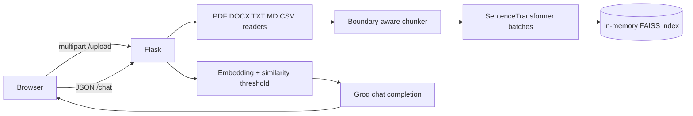

# ChatWithDoc

ChatWithDoc is a small Flask retrieval-augmented question answering app. Users upload PDF, DOCX, TXT, Markdown, or CSV files, then ask questions about the extracted text through Groq.

## Architecture



The Flask session cookie stores only a random session id. Indexes, chunks, and the last five question/answer pairs live in a bounded, lock-protected in-memory LRU store. This keeps document data out of the 4 KB cookie limit and prevents different browser sessions from sharing documents.

## Setup

```bash
python -m venv .venv
.venv/bin/pip install -r requirements.txt
cp .env.example .env
# Put GROQ_API_KEY in .env
.venv/bin/python app.py
```

The default embedding model is `BAAI/bge-large-en-v1.5`. Set `EMBEDDING_MODEL=BAAI/bge-m3` for multilingual retrieval. BGE-M3 accepts document and query text directly; this project does not add an instruction prefix.

Run tests with `.venv/bin/python -m pytest -q`.

## Environment variables

| Variable | Default | Purpose |
|---|---|---|
| `GROQ_API_KEY` | none | Groq API credential |
| `SECRET_KEY` | generated at startup | Flask signing key |
| `EMBEDDING_MODEL` | `BAAI/bge-large-en-v1.5` | SentenceTransformer model |
| `MIN_SCORE` | `0.40` | Minimum normalized FAISS score |
| `TOP_K` | `4` | Retrieved chunks for normal questions |
| `FLASK_DEBUG` | `false` | Flask development debug mode |

## API routes

- `GET /` serves the web interface.
- `POST /upload` accepts repeated multipart fields named `file` and returns `{"status": "..."}`. Supported extensions are `.pdf`, `.docx`, `.txt`, `.md`, and `.csv`.
- `POST /chat` accepts `{"question": "...", "mode": "student"}` and always returns `{"answer": "..."}` plus optional `sources` and `timings_ms` fields.

Modes include `student`, `medical`, `legal`, `research`, and `summarize`. Follow-up questions are rewritten for retrieval when history exists, while the original question is sent to the answer prompt.

## Measured timings

The focused regression suite on this machine completed in **5.38 seconds** for four tests. The tests mock model and network calls, so they do not represent model inference. Live stage timing values are emitted in logs and in `/chat`'s `timings_ms` response; no real document/model benchmark was recorded because the default model was not downloaded.

| Measurement | Result |
|---|---:|
| Focused regression suite, 4 tests | 5.38 s |
| Live parsing/chunking/embedding/indexing | not measured |
| Live query embedding/FAISS/Groq | not measured |

## Known limitations

- Scanned and image-only PDFs need OCR, which is not included.
- The store is in memory and is lost on restart; it is capped at 50 sessions.
- Multiple workers do not share the in-memory store.
- Groq access requires a valid API key and network access.
- Uploaded content is decoded as UTF-8 for text-like formats.

## Future work

- Add optional OCR for scanned PDFs.
- Add a persistent, encrypted document store when deployment needs it.
- Add reranking and evaluation datasets for retrieval quality.
- Add streaming answers and richer source navigation.
- Add a background job for large uploads.
